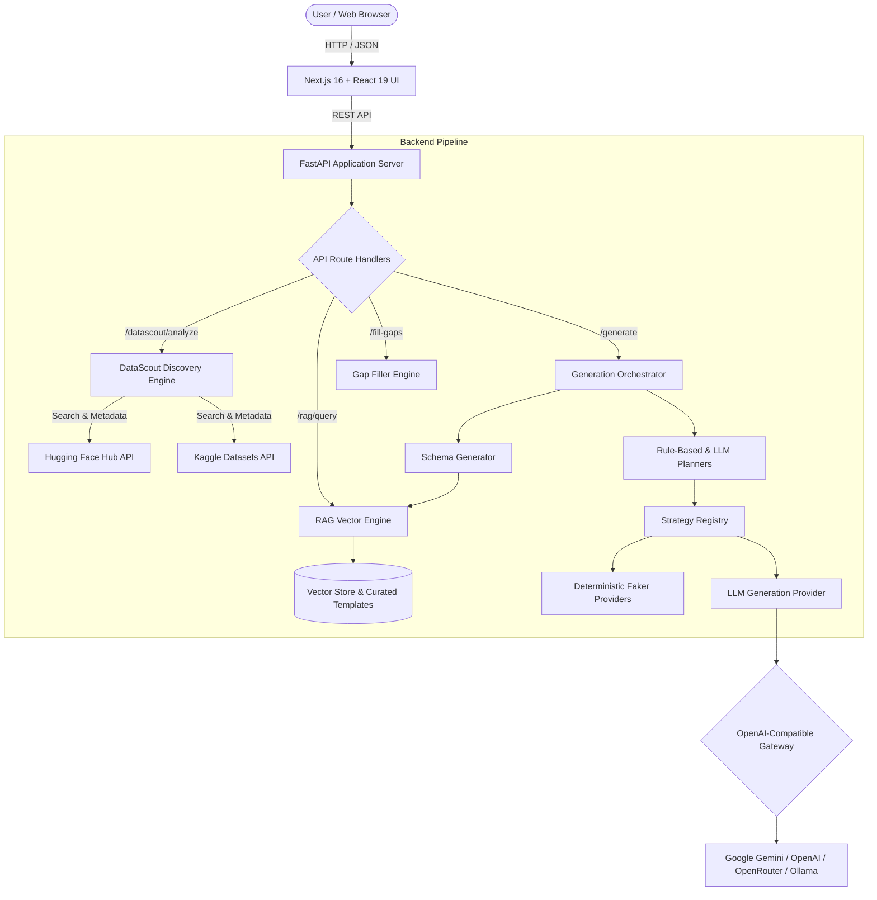

<div align="center">

# Synthetic Data Studio

**Enterprise-grade, AI-driven synthetic dataset generation, discovery, and profiling platform.**

[](https://opensource.org/licenses/MIT)
[](https://www.python.org/)
[](https://fastapi.tiangolo.com)
[](https://nextjs.org/)
[](https://react.dev/)
[](https://www.typescriptlang.org/)
[](https://tailwindcss.com/)
[](https://github.com/Shivanshm29/synthetic-data-studio/actions)

<p align="center">
  <a href="#overview">Overview</a> •
  <a href="#key-features">Key Features</a> •
  <a href="#system-architecture">Architecture</a> •
  <a href="#generation-pipeline">Pipeline Details</a> •
  <a href="#repository-structure">Repository Structure</a> •
  <a href="#quickstart">Quickstart</a> •
  <a href="#configuration-reference">Configuration</a> •
  <a href="#api-reference-overview">API Reference</a> •
  <a href="#testing--verification">Testing</a> •
  <a href="#contributing">Contributing</a>
</p>

</div>

---

## Overview

**Synthetic Data Studio** is a full-stack, enterprise-ready platform that converts natural language prompts into production-grade structured datasets. Designed for machine learning engineers, data scientists, software architects, and QA teams, the studio bridges the gap between raw generative models and deterministic data integrity.

By combining Large Language Models (LLMs), automated external dataset discovery (Hugging Face Hub and Kaggle Datasets), high-throughput deterministic synthesis (Faker), and vector-backed Retrieval-Augmented Generation (RAG), Synthetic Data Studio generates realistic, privacy-compliant, relational tabular data in seconds without manual schema definition.

### Primary Use Cases

- **Cold-Start ML Training**: Generate balanced training data with complex multi-column constraints before production telemetry is available.
- **Privacy-Compliant Staging Environments**: Synthesize high-fidelity replacements for sensitive PII/PHI (HIPAA, GDPR) datasets.
- **Class Imbalance & Edge Case Augmentation**: Impute missing features and amplify under-represented cohorts in existing datasets.
- **Microservice & Database Mocking**: Generate relational tables with referential integrity (e.g. matching first names, surnames, and corporate email addresses) for integration testing.

---

## Key Features

- **Natural Language Schema Inference**: Specify dataset objectives in plain English (e.g., *"E-commerce transactions for credit card fraud detection with customer demographics and risk scores"*). The engine infers column names, data types, value distributions, and constraints automatically.
- **Intelligent DataScout Discovery Engine**: Before spending compute generating synthetic data from scratch, DataScout searches Hugging Face and Kaggle APIs for verified public datasets matching your prompt, saving compute and indexing existing open datasets.
- **Hybrid Multi-Strategy Generation Engine**:
  - **Deterministic Algorithmic Generation**: High-throughput providers produce realistic names, physical addresses, contextual emails, dates, phone numbers, UUIDs, and numerical ranges.
  - **Context-Aware Semantic Generation**: LLM synthesis handles complex open-domain descriptions, product reviews, and unstructured free text.
  - **Cross-Column Coherence**: Generates correlated columns where emails derive from generated first and last names, and numerical distributions respect relational boundaries.
- **Gap Analysis and Dataset Augmentation**: Profile existing datasets (CSV or fetched repositories), detect sparse or missing attributes, and seamlessly synthesize new columns that match the existing distribution.
- **RAG-Assisted Schema Guidance**: Ingests industry-standard templates (Finance, Healthcare, E-Commerce, Logistics, SaaS, HR) into an embedded vector store to guarantee realistic schema layouts.
- **Multi-Provider LLM Architecture**: Native support for Google Gemini, OpenAI, OpenRouter (DeepSeek, Claude, Llama 3), and local offline models via Ollama, equipped with automated production model fallback.
- **Interactive Dark-Themed Studio UI**: Built with Next.js 16, React 19, and Tailwind CSS v4, providing real-time tabular data exploration, search filters, schema inspection, and instant client-side exports to CSV, JSON, and JSONL.

---

## System Architecture



---

## Generation Pipeline

1. **Prompt Ingestion & RAG Context Injection**: The user prompt is vectorized and evaluated against curated schema templates. If relevant production schemas are identified (e.g., healthcare patient admissions, fintech transaction logs), structural context is injected into the LLM system prompt.
2. **Schema & Constraint Synthesis**: The LLM infers the dataset contract (`DatasetSpecification`), outputting typed column definitions, bounds, relational expectations, and per-column descriptions.
3. **Execution Planning**: The `GenerationOrchestrator` passes the specification to the planner (`RuleBasedPlanner` or `LLMPlanner`). The planner maps each column to an optimal strategy:
   - High-cardinality identity fields (UUIDs, IDs) $\rightarrow$ Deterministic sequence or UUID strategy.
   - Correlated identity fields (First Name, Last Name, Email) $\rightarrow$ Contextual dependent strategies.
   - Structured primitives (Integers, Floats, Dates, Booleans) $\rightarrow$ Bounded distribution strategies.
   - Free-form text (Reviews, Bios, Summaries) $\rightarrow$ Batched LLM semantic synthesis.
4. **Data Synthesis & Context Resolution**: The orchestrator iterates over planned rows, maintaining a `GenerationContext` so that downstream columns have read access to already synthesized attributes in the current row.
5. **Serialization & Client Delivery**: Formatted rows are returned to the frontend for interactive table rendering and zero-lag client-side export.

---

## Repository Structure

```
synthetic-data-studio/
├── .github/                      # GitHub Actions workflows & issue templates
│   ├── workflows/ci.yml          # Automated CI (Python 3.11/3.12 tests + Frontend checks)
│   └── ISSUE_TEMPLATE/           # Bug report and feature request templates
├── backend/                      # FastAPI Python Application
│   ├── app/
│   │   ├── api/                  # REST route controllers & Pydantic schemas
│   │   │   ├── routes/           # Endpoints: generate, datascout, fill_gaps, rag, health
│   │   │   └── schemas/          # Request & response data contracts
│   │   ├── core/                 # Config & settings via pydantic-settings
│   │   ├── datascout/            # Hugging Face & Kaggle discovery & profiler
│   │   ├── domain/               # Core data models (Column, Dataset, Constraint)
│   │   ├── generation/           # Orchestrator, planners, & Faker/LLM strategies
│   │   ├── rag/                  # Vector store & template knowledge base
│   │   └── main.py               # FastAPI application entry point
│   ├── tests/                    # Unit tests & verification suite
│   ├── .env.example              # Template backend environment variables
│   └── requirements.txt          # Python dependencies
├── frontend/                     # Next.js 16 Web Application
│   ├── app/
│   │   ├── components/           # UI components (DataTable, PromptInput, etc.)
│   │   ├── lib/                  # Typed API client & data interfaces
│   │   ├── layout.tsx            # Global layout & metadata
│   │   ├── page.tsx              # Main studio interactive dashboard
│   │   └── globals.css           # Styling with Tailwind CSS v4
│   ├── .env.example              # Template frontend environment variables
│   ├── package.json              # Node.js dependencies & scripts
│   └── tsconfig.json             # TypeScript configuration
├── docs/                         # Extended documentation
│   ├── ARCHITECTURE.md           # Deep architectural specification
│   └── API_REFERENCE.md          # REST API endpoints & payload specifications
├── LICENSE                       # MIT License
└── README.md                     # Project documentation
```

---

## Quickstart

### Prerequisites

- **Python**: 3.11 or 3.12
- **Node.js**: 20.x or higher
- **Package Managers**: `pip` and `npm`

---

### 1. Clone Repository

```bash
git clone https://github.com/Shivanshm29/synthetic-data-studio.git
cd synthetic-data-studio
```

---

### 2. Backend Setup

```bash
# Navigate to backend directory
cd backend

# Create and activate virtual environment
python -m venv .venv

# On Windows (PowerShell):
.venv\Scripts\Activate.ps1

# On Linux / macOS:
source .venv/bin/activate

# Install dependencies
pip install -r requirements.txt

# Configure environment variables
cp .env.example .env
```

Open `backend/.env` and supply your LLM credentials. The default and recommended provider is **Google Gemini**:

```env
LLM_API_KEY=your_gemini_api_key_here
LLM_MODEL=gemini-2.5-flash
LLM_BASE_URL=https://generativelanguage.googleapis.com/v1beta/openai/
```

Start the FastAPI application server:

```bash
uvicorn app.main:app --reload --port 8000
```

The backend server is accessible at `http://localhost:8000`. Interactive OpenAPI documentation is available at `http://localhost:8000/docs`.

---

### 3. Frontend Setup

In a separate terminal window:

```bash
# Navigate to frontend directory
cd frontend

# Install dependencies
npm ci

# Launch the Next.js development server
npm run dev
```

Navigate to **[http://localhost:3000](http://localhost:3000)** to access the Synthetic Data Studio dashboard.

---

## Configuration Reference

The backend configuration is managed by Pydantic Settings in `backend/app/core/config.py` and reads from `backend/.env`:

| Variable | Type | Default | Description |
|---|---|---|---|
| `LLM_API_KEY` | String | `test-key` | API key for your LLM provider. |
| `LLM_MODEL` | String | `gemini-2.5-flash` | Primary model identifier. |
| `LLM_BASE_URL` | String | Google OpenAI Endpoint | Base URL for OpenAI-compatible client requests. |
| `KAGGLE_API_TOKEN` | String | `None` | *(Optional)* Kaggle API key for authenticated dataset discovery. |
| `HF_TOKEN` | String | `None` | *(Optional)* Hugging Face access token for expanded rate limits. |

### Supported Model Providers

#### Google Gemini (Recommended Default)

Google's current Gemini generation offers low latency, high throughput, and strict JSON Schema compliance:

- **`gemini-2.5-flash`**: Recommended for optimal balance between reasoning accuracy and synthesis throughput.
- **`gemini-2.5-pro`**: Recommended for complex nested schemas and highly specialized domains.

```env
LLM_API_KEY=your_google_ai_studio_api_key
LLM_MODEL=gemini-2.5-flash
LLM_BASE_URL=https://generativelanguage.googleapis.com/v1beta/openai/
```

> The backend automatically includes verified production fallbacks (`gemini-2.5-flash`, `gemini-2.0-flash`, `gemini-2.5-pro`) to ensure requests succeed even under upstream model migration.

#### OpenAI

```env
LLM_API_KEY=sk-proj-your_openai_api_key
LLM_MODEL=gpt-4o-mini
LLM_BASE_URL=https://api.openai.com/v1
```

#### OpenRouter

```env
LLM_API_KEY=sk-or-v1-your_openrouter_api_key
LLM_MODEL=deepseek/deepseek-chat
LLM_BASE_URL=https://openrouter.ai/api/v1
```

#### Local Ollama (Offline / Self-Hosted)

```env
LLM_API_KEY=ollama
LLM_MODEL=llama3.1:8b
LLM_BASE_URL=http://localhost:11434/v1
```

---

## API Reference Overview

Full endpoint documentation and request/response payloads are detailed in [docs/API_REFERENCE.md](docs/API_REFERENCE.md).

| Method | Endpoint | Description |
|---|---|---|
| `GET` | `/health` | Application health and readiness probe. |
| `POST` | `/generate` | Generate synthetic tabular dataset from an explicit schema specification. |
| `POST` | `/generate/prompt` | End-to-end prompt-to-dataset generation pipeline. |
| `POST` | `/datascout/analyze` | Discovery query against Hugging Face and Kaggle with heuristic matching. |
| `POST` | `/datascout/fetch` | Fetch live sample rows from public dataset repositories. |
| `POST` | `/datascout/analyze-gaps` | Profile dataset columns and identify null, missing, or low-variance fields. |
| `POST` | `/datascout/fill-gaps` | Augment existing datasets by synthesizing replacement columns. |
| `GET` | `/rag/templates` | Retrieve curated domain schema templates from vector store. |
| `POST` | `/rag/query` | Retrieve top-$k$ nearest schema templates using cosine similarity. |

---

## Testing & Verification

### Backend Unit Tests

Run the full Python test suite:

```bash
cd backend
python -m unittest discover -s tests -p "test_*.py"
```

The test suite validates:
- Heuristic fallback and API search in the DataScout engine.
- Synthetic generation robustness across names, contextual emails, roll numbers, and bounded numerical parameters.
- Rule-based planner strategy inference and end-to-end generation orchestration.
- Configuration loading resilience in the absence of a `.env` file.

### Frontend Quality Checks

Run linting, type-checking, and production build checks:

```bash
cd frontend

# Verify ESLint rules
npm run lint

# Verify TypeScript types without emitting artifacts
npx tsc --noEmit

# Verify production Next.js build
npm run build
```

---

## Contributing

Contributions and issue reports are welcome.

1. Fork the repository.
2. Create a feature branch (`git checkout -b feat/your-feature-name`).
3. Commit your changes following [Conventional Commits](https://www.conventionalcommits.org/) (`git commit -m 'feat: add parquet export capability'`).
4. Ensure all backend tests (`python -m unittest discover -s tests -p "test_*.py"`) and frontend checks (`npm run lint`, `npx tsc --noEmit`) pass.
5. Push to your branch and open a Pull Request.

---

## License

This project is licensed under the **MIT License** — see the [LICENSE](LICENSE) file for details.
